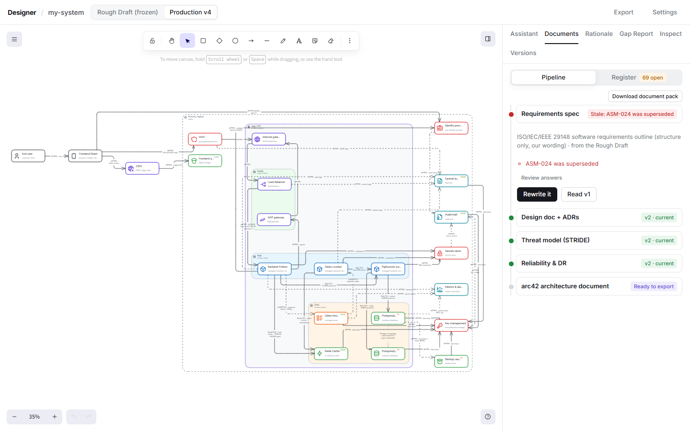
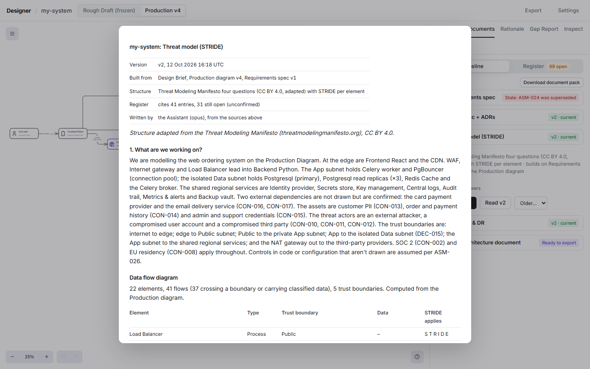
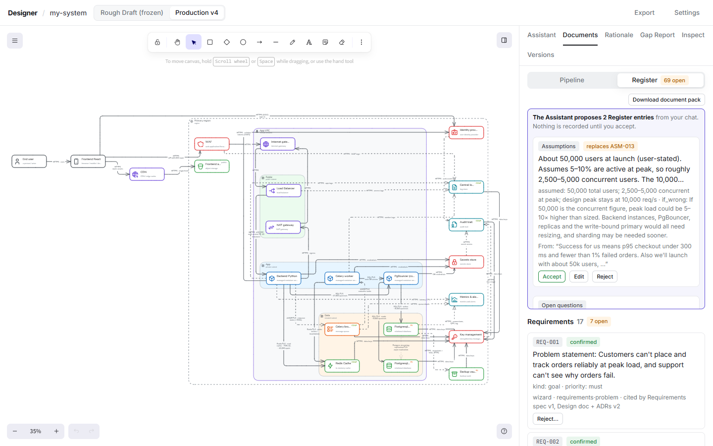

# Documents and the Register

The Documents tab writes the documents a senior engineer is expected to produce, each building on the ones before it:

| Document | Built on | Structure |
|---|---|---|
| Requirements spec | the Brief and the Rough Draft | ISO/IEC/IEEE 29148 outline |
| Design doc + ADRs | the Requirements spec and the Production Diagram | design doc / RFC outline; ADRs in MADR 4.0 |
| Threat model (STRIDE) | the Production Diagram | the Threat Modeling Manifesto's four questions, STRIDE per element |
| Reliability & DR | the Production Diagram and the Requirements spec | SLOs and error budgets, failure modes, backup and recovery, a NIST SP 800-34 style contingency plan |
| arc42 architecture document | everything above | the arc42 template, exported as Word or PDF |

## Writing a document

1. Open a Step. It shows its status: waiting for an earlier document, questions to answer, ready, current, or stale (with the reasons).
2. Answer its questions, one per screen. Answers are recorded in the Register as confirmed entries. **Unknown** is allowed for all but a few required questions; the Assistant then states what it assumes.
3. **Write it**. The Assistant writes the sections, cites Register entries by ID for its claims, and adds new entries (assumptions, decisions, risks, open questions) as **open** for you to review. Some sections are computed without AI: the data flow diagram and STRIDE table, error budgets, a failure-mode skeleton.
4. **Read** the result. Every version is kept; older ones are under **Older…**.

A document goes **stale** when the Brief, the diagram, an earlier document or an answer changes, or when an entry it cites is rejected or superseded. It is never rewritten automatically: you choose when to **Rewrite it**.

## The Register

The Register tab is the audit trail: every requirement, constraint, assumption, non-goal, decision, risk and open question, with where it came from (the Brief, a wizard answer, chat, the Assistant, the Design Rationale), which documents cite it, and its full history.

- **Confirm** or **Reject…** what the Assistant added. Rejecting can replace the entry with your own wording. Only you can confirm or reject.
- **Draft a fix** on a risk or open question asks the Assistant for a Proposal that resolves it. Accepting that Proposal closes the entry with a decision that names the Proposal.
- Hovering an entry highlights the diagram elements it's about.
- Entries are never edited, only superseded, and the file is hash-chained: if it's edited outside Designer, the Documents tab says so.

## From chat

When you state a requirement or constraint in chat ("data must stay in the EU", "no mobile app in v1"), the Assistant proposes it as a Register entry. A review card appears in the Assistant tab: **Accept**, **Edit** or **Reject**. Nothing is recorded until you accept, and the entry keeps the message it came from.
