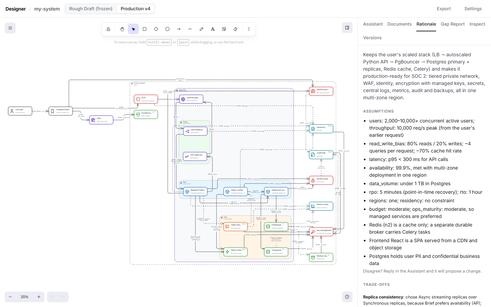

# Getting started

## Install

Install [Claude Code](https://claude.com/claude-code) and log in (run `claude` and follow the prompts). Then install Designer:

- macOS, Linux: `curl -fsSL https://raw.githubusercontent.com/vinaayakh/designer/main/scripts/install.sh | sh`
- Windows: `irm https://raw.githubusercontent.com/vinaayakh/designer/main/scripts/install.ps1 | iex`

## Open a Project

```sh
designer ~/my-system
```

A Project is a folder. If it's empty, Designer creates the files it needs; if it already holds a Project, it opens it. The browser opens at `http://127.0.0.1:4717` (or the next free port). Stop Designer with Ctrl+C; everything is already saved.

Keep the Project in git if you like: every file except `.designer/` (runtime state and logs) is meant to be committed and diffs well.

## The screen



- **Canvas** (left): the Rough Draft, or the Production Diagram once it exists. The header switches between them and shows the version you're on.
- **Sidebar** (right), in tabs:
  - **Assistant**: chat, the Assistant's progress, and review cards for entries it proposes.
  - **Documents**: the Document Pipeline and the Register.
  - **Rationale**: why each component exists and which practices it applies.
  - **Gap Report**: compliance and security findings.
  - **Inspect**: the selected element's kind, service, data classification and connections.
  - **Versions**: every Production version.
- **Export** and **Settings** are in the header. Settings holds the models the Assistant uses and the Design Brief.

## What it costs

Each AI task runs in your Claude Code session and is billed to your Claude account. The Assistant header shows the session's cost so far. As a guide, from test runs: a chat reply costs a few cents, and a Conversion or a document roughly $0.20–0.50.
