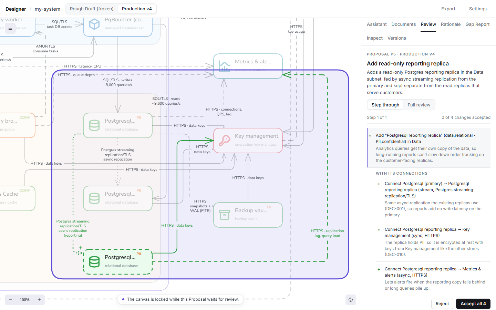
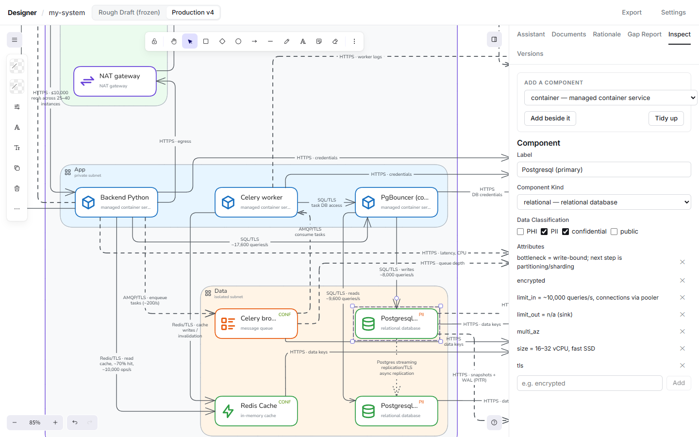

# Proposals and versions

## Asking for changes

Ask in the Assistant tab: "add a read replica", "move the cache into the private subnet", "why is there a NAT gateway?". Click elements to add them to the message's context.

The Assistant never edits the diagram directly. A change comes back as a **Proposal**: a list of operations (add, update, move, remove), each with a reason.

## Reviewing a Proposal

The Review tab steps through the changes one at a time, showing each in place on the canvas. Accept a change, or reject it with a reason and the Assistant reworks the rest. You can also reply to the whole Proposal, or answer a question the Assistant asks. Changes that depend on each other stay together.

Accepting saves a new Production version. Nothing is applied until you accept.

## Editing by hand

You can also edit the Production Diagram directly; the Inspector sets an element's kind, service, data classification and connections. Edits made within 10 minutes of each other are saved as one version. **Tidy up** re-runs the automatic layout.

## Versions

The Versions tab lists every version and what created it (Conversion, a Proposal, hand edits). Open any version read-only, or restore it as a new version.
